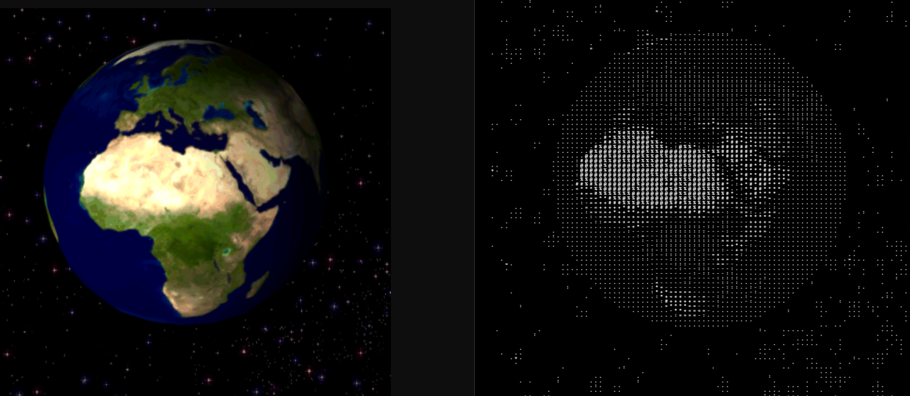

# ASCII Art GIF Converter

Convert GIFs to ASCII art with interactive zoom and export options.

[](https://asciigif.com/)



## What It Does
- Transform animated GIFs into text-based art. Zoom, pan, and export in multiple formats including GIF, ASCII, JSON, and CSV.

## How to Use
Enter a GIF URL, click to zoom, scroll to adjust, drag to pan. Export the result in your preferred format.

## Development Setup

1. Clone the repository:
```bash
git clone https://github.com/yourusername/ascii-gif-converter.git
cd ascii-gif-converter
```

2. Set `GIPHY_API_KEY` in your shell (get one from [Giphy Developers](https://developers.giphy.com/)).

3. Build and serve:
```bash
GIPHY_API_KEY=... npm run dev
```

No dependencies to install. `npm test` runs the ASCII mapping self-check; `npm run build` writes `dist/`.

The app will be available at `http://localhost:3000`

## Tech Stack
- Vanilla JavaScript
- p5.js - For canvas rendering
- GSAP - For smooth animations
- gif.js - For GIF processing

<div align="center">
  
  
  
</div>

## Analytics
View usage statistics at [ascii.goatcounter.com](https://ascii.goatcounter.com/)
